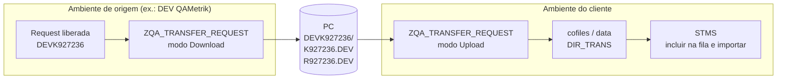
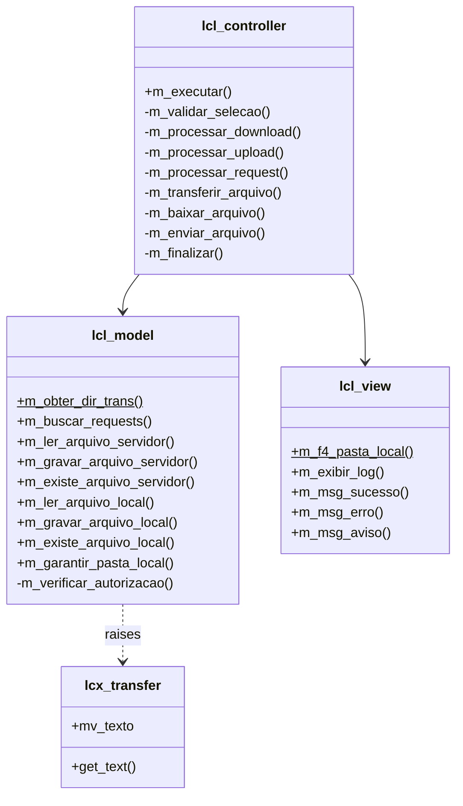

# ZQA_TRANSFER_REQUEST


> Download e upload dos arquivos de transporte SAP (**cofile** e **data**) informando só o número da request. Substitui o uso manual das transações **CG3Y** e **CG3Z**.

Desenvolvido pela **QAMetrik Tecnologia** para agilizar a entrega de produtos e correções nos ambientes dos clientes.

---

## Sumário

- [Por que existe](#por-que-existe)
- [Funcionalidades](#funcionalidades)
- [Fluxo de entrega](#fluxo-de-entrega)
- [Pré-requisitos](#pré-requisitos)
- [Instalação](#instalação)
- [Tela de seleção](#tela-de-seleção)
- [Como usar](#como-usar)
- [Log de execução](#log-de-execução)
- [Cofile x Data](#cofile-x-data)
- [Erros comuns](#erros-comuns)
- [Arquitetura técnica](#arquitetura-técnica)
- [Limitações conhecidas](#limitações-conhecidas)
- [Histórico de versões](#histórico-de-versões)

---

## Por que existe

Para levar uma request de um ambiente para outro sem rota de transporte (por exemplo, do ambiente QAMetrik para o cliente), o processo manual é:

1. Abrir a **CG3Y** e baixar o cofile `K<número>.<SID>`, indicando o caminho completo no servidor.
2. Repetir para o data `R<número>.<SID>`.
3. No cliente, abrir a **CG3Z** e subir cada arquivo para a pasta certa (`cofiles` ou `data`).

O **ZQA_TRANSFER_REQUEST** faz tudo isso em **uma execução por ambiente**: você informa a request e o programa monta os nomes e caminhos e transfere os dois arquivos.

## Funcionalidades

- **Dois modos:** Download (servidor → PC) e Upload (PC → servidor).
- **Várias requests** em uma única execução.
- **Nomes e caminhos automáticos:** `DEVK927236` gera `K927236.DEV` e `R927236.DEV`.
- **Diretório de transporte** lido automaticamente do parâmetro `DIR_TRANS`.
- **Subpasta por request** no PC, com a mesma estrutura no download e no upload.
- **Proteção contra sobrescrita**, no PC e no servidor.
- **Validações:**
  - existência da request (E070);
  - request liberada;
  - formato `<SID>K<número>`;
  - autorização S_DATASET.
- **Log ALV** com semáforo por arquivo.

## Fluxo de entrega



## Pré-requisitos

| Item | Detalhe |
|---|---|
| Release | SAP ECC 6.0 EhP7+ (ABAP 7.40) ou S/4HANA |
| Execução | Em diálogo (SAP GUI para Windows). Não funciona em background |
| Request (download) | Deve estar **liberada** (status `R` ou `N`). Informe a request, não a tarefa |
| Autorização | **S_DATASET**, conforme a tabela abaixo |

| Campo | Download | Upload |
|---|---|---|
| ACTVT | `33` (leitura) | `34` (gravação) |
| PROGRAM | `ZQA_TRANSFER_REQUEST` | `ZQA_TRANSFER_REQUEST` |
| FILENAME | `<DIR_TRANS>/*` | `<DIR_TRANS>/*` |

## Instalação

O programa precisa existir **nos dois ambientes**, na origem (download) e no cliente (upload).

**Opção 1 – abapGit**

Faça o pull deste repositório pelo [abapGit](https://abapgit.org) em um pacote Z, ou em `$TMP` para uso local.

**Opção 2 – Manual**

1. Na **SE38**, crie o report `ZQA_TRANSFER_REQUEST` (tipo executável).
2. Cole o conteúdo de [`src/zqa_transfer_request.prog.abap`](src/zqa_transfer_request.prog.abap).
3. Cadastre os elementos de texto:

| Tipo | Chave | Texto |
|---|---|---|
| Símbolo | 001 | Requests de transporte |
| Símbolo | 002 | Pasta e opções |
| Símbolo | 003 | Operação |
| Seleção | P_DOWN | Download (Servidor -> PC) |
| Seleção | P_UP | Upload (PC -> Servidor) |
| Seleção | SO_TRK | Request(s) |
| Seleção | P_PASTA | Pasta no PC |
| Seleção | P_DIRTR | Diretório de transporte (servidor) |
| Seleção | P_SUBP | Subpasta por request |
| Seleção | P_SOBR | Sobrescrever arquivos existentes |

4. Ative.

## Tela de seleção

### Operação

| Campo | Descrição |
|---|---|
| **Download (Servidor → PC)** | Lê os arquivos em `DIR_TRANS/cofiles` e `DIR_TRANS/data` e grava no PC |
| **Upload (PC → Servidor)** | Lê os arquivos no PC e grava em `DIR_TRANS/cofiles` e `DIR_TRANS/data` |

### Requests de transporte

| Campo | Obrigatório | Descrição |
|---|---|---|
| **Request(s)** | Sim | Uma ou mais requests (ex.: `DEVK927236`), por seleção múltipla. Não aceita intervalo |

### Pasta e opções

| Campo | Padrão | Descrição |
|---|---|---|
| **Pasta no PC** | — | Pasta local de destino (download) ou de origem (upload). O F4 abre o seletor de pastas |
| **Diretório de transporte** | `DIR_TRANS` | Raiz do diretório de transporte no servidor (normalmente `/usr/sap/trans`) |
| **Subpasta por request** | Marcado | Download: cria `<pasta>\<request>\`. Upload: procura os arquivos em `<pasta>\<request>\` |
| **Sobrescrever** | Desmarcado | Download: substitui o arquivo no PC. Upload: substitui o arquivo no servidor |

> ⚠️ **Cuidado no upload:** o cofile no cliente guarda o histórico de importação da request. Só marque **Sobrescrever** quando tiver certeza de que a request ainda não foi importada ou de que precisa reenviar a versão nova.

Estrutura gerada no PC com **Subpasta por request** marcado:

```
C:\Transportes\Cliente_X\
└── DEVK927236\
    ├── K927236.DEV   ← cofile
    └── R927236.DEV   ← data
```

## Como usar

### 1. Download (ambiente de origem)

1. Libere a request na **SE09/SE10**.
2. Execute o `ZQA_TRANSFER_REQUEST` e marque **Download**.
3. Informe a(s) request(s) e a pasta no PC.
4. Execute (**F8**) e confira o log.

### 2. Upload (ambiente do cliente)

1. Execute o `ZQA_TRANSFER_REQUEST` e marque **Upload**.
2. Informe a(s) mesma(s) request(s) e a **mesma pasta** usada no download.
3. Execute (**F8**) e confira o log.

### 3. Importação

1. Abra a **STMS** → *Visão geral das importações* → sistema de destino.
2. Vá em *Extras → Outras requests → Incluir* e informe a request.
3. Importe a request.

## Log de execução

| Status | Significado |
|---|---|
| 🟢 | Transferência realizada com sucesso |
| 🟡 | O arquivo já existia no destino e não foi sobrescrito |
| 🔴 | Erro. O motivo aparece na coluna **Mensagem** |

Colunas: Status · Operação · Request · Descrição · Tipo (`COFILE`/`DATA`) · Arquivo no servidor · Arquivo no PC · Tamanho (bytes) · Mensagem.

## Cofile x Data

| | Cofile | Data |
|---|---|---|
| Nome | `K<número>.<SID>` | `R<número>.<SID>` |
| Pasta no servidor | `cofiles` | `data` |
| Conteúdo | Controle da request (etapas, sistemas, códigos de retorno) | Objetos da request (código, dicionário, customizing) |
| Tamanho típico | Poucos KB | Varia com os objetos |

Para não confundir: o arquivo **K** vai para **cofiles** e o arquivo **R** vai para **data**.

## Erros comuns

| Mensagem | Causa | Solução |
|---|---|---|
| Request não encontrada na E070 ou é uma tarefa | Número errado ou foi informada a tarefa (download) | Informe a request principal |
| Request não liberada | A request ainda está modificável | Libere na SE09/SE10 |
| Formato de request inválido | Não segue `<SID>K<número>` | Corrija o número |
| Sem autorização S_DATASET … | Falta a ACTVT 33 ou 34 para o programa | Execute a **SU53** e solicite ao Basis |
| Arquivo não encontrado no servidor | Caminho errado ou a request não gerou o arquivo | Confira na **AL11** |
| Arquivo não encontrado no PC | Pasta errada ou opção de subpasta diferente da usada no download | Ajuste a pasta ou a opção **Subpasta por request** |
| Arquivo já existe no PC/servidor | Proteção contra sobrescrita | Marque **Sobrescrever**, se for o caso |
| Não foi possível gravar no servidor | Diretório inexistente ou sem permissão no sistema operacional | Confira o diretório na **AL11** e as permissões com o Basis |
| Transferência … em background | O programa foi executado em job | Execute em diálogo |

## Arquitetura técnica

Report ABAP OO no padrão **MVC com classes locais** (padrão QAMetrik).



| Componente | Responsabilidade | Recursos SAP utilizados |
|---|---|---|
| `lcl_model` | Banco, servidor de aplicação e frontend | `E070`, `E07T`, `C_SAPGPARAM`, `AUTHORITY_CHECK_DATASET`, `OPEN/READ/TRANSFER DATASET` (binário), `CL_GUI_FRONTEND_SERVICES`, `CL_BCS_CONVERT` |
| `lcl_view` | Interação e saída | `CL_SALV_TABLE`, `DIRECTORY_BROWSE`, `MESSAGE` |
| `lcl_controller` | Regras e orquestração | Validação, nomes K/R, consolidação do log |
| `lcx_transfer` | Exceção local | Texto exibido no log |

**Regra de nomes:** a request `SSSKnnnnnn` gera o cofile `Knnnnnn.SSS` e o data `Rnnnnnn.SSS`.

## Limitações conhecidas

- **Fila de importação:** o programa não inclui a request na fila. Esse passo continua na STMS.
- **Execução:** só em diálogo, porque depende do SAP GUI para acessar o PC.
- **`TABLES e070`:** usado só como referência de tipo do `SELECT-OPTIONS`.
- **`DIR_TRANS`:** é lido via `CALL 'C_SAPGPARAM'`. Se a ATC apontar essa chamada, remova o valor padrão do `INITIALIZATION` e informe o diretório na tela.

## Histórico de versões

| Versão | Data | Autor | Descrição |
|---|---|---|---|
| 1.0 | 16/10/2026 | João Luís Medeiros | Download de cofile e data (`ZQA_DOWNLOAD_REQUEST`) |
| 1.1 | 16/10/2026 | João Luís Medeiros | Correção da atividade S_DATASET e mensagens de erro detalhadas |
| 2.0 | 16/10/2026 | João Luís Medeiros | Modo Upload, novo nome `ZQA_TRANSFER_REQUEST` e coluna Operação no log |

---

© QAMetrik Tecnologia — [www.qametrik.com](https://www.qametrik.com)
